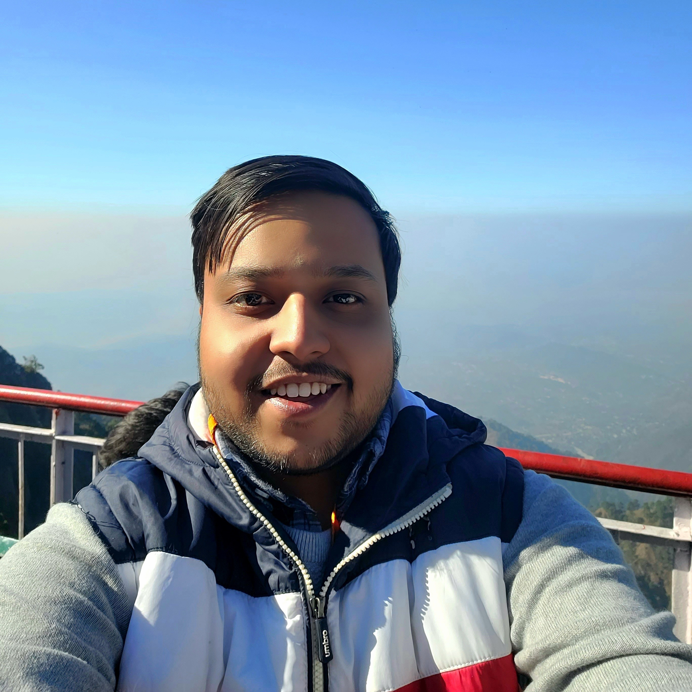

::: {.hero}
::: {.hero-copy}

[Hi, I'm Utkarsh]{.kicker}

# Building end-to-end ML systems — and writing about them.

Data Scientist and AI/ML Engineer with 3+ years shipping computer vision, NLP, generative AI, and big-data systems. Currently focused on transformers, RAG, embedding fine-tuning, and LLM applications.

::: {.hero-actions}

[About me](about.qmd){.btn .btn-primary} [Explore projects](projects/projects.qmd){.btn .btn-outline-secondary}

:::

::: {.social-chips}

<a class="chip-link" href="https://github.com/Utkarsh736"><i class="bi bi-github"></i>GitHub</a>
<a class="chip-link" href="https://www.linkedin.com/in/utkarsh736/"><i class="bi bi-linkedin"></i>LinkedIn</a>
<a class="chip-link" href="https://twitter.com/Utkarsh736"><i class="bi bi-twitter-x"></i>Twitter</a>
<a class="chip-link" href="https://huggingface.co/Utkarsh736"><i class="bi bi-emoji-smile"></i>HuggingFace</a>
<a class="chip-link" href="https://www.kaggle.com/utkarshtomar736"><i class="bi bi-bar-chart-line"></i>Kaggle</a>
<a class="chip-link" href="https://bsky.app/profile/utkarsh736.bsky.social"><i class="bi bi-bluesky"></i>Bluesky</a>
<a class="chip-link" href="https://dagshub.com/Utkarsh736"><i class="bi bi-diagram-3"></i>DagsHub</a>

:::

:::

::: {.hero-side}

::: {.hero-photo}

:::

:::

:::

::: {.section-head}
::: {}

## Featured Projects

Tools, labs, and production-minded experiments across CV, NLP, agents, and retrieval.

:::

[All projects <i class="bi bi-arrow-right"></i>](projects/projects.qmd){.section-more}
:::

::: {#landing-projects}
:::

::: {.section-head}
::: {}

## Latest Writing

Notes on machine learning, transformers, and experiments.

:::

[All posts <i class="bi bi-arrow-right"></i>](blogs/blogs.qmd){.section-more}
:::

::: {#landing-blogs}
:::
